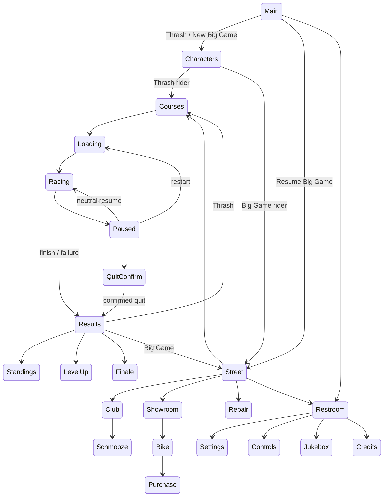

# Frontend, career and economy

The new `rr-session` crate contains typed `Screen`, `Frontend`, `Career`, `Catalog`, `RaceIdentity` and immutable `Summary` records. It depends on the simulation and bounded executable reader, with no Bevy, renderer, entities or platform I/O. `apps/game/src/frontend/` separately contains the Bevy coordinator, input adapter, view, snapshot storage bridge and adapter tests. Race physics/replays remain in `rr-simulation`.

Pinned research: [career tables and transactions](https://github.com/arkits/road-rash/blob/7aecf6044f2dd773b925b325823f30d648d61c89/src/career.cpp), [frontend](https://github.com/arkits/road-rash/blob/7aecf6044f2dd773b925b325823f30d648d61c89/src/frontend.cpp), [native screens](https://github.com/arkits/road-rash/blob/7aecf6044f2dd773b925b325823f30d648d61c89/src/native_screens.cpp), [native strings](https://github.com/arkits/road-rash/blob/7aecf6044f2dd773b925b325823f30d648d61c89/src/native_strings.cpp). Original-runtime comparisons remain waived; static table/API comparisons are independently recorded.

## Running the flows

```bash
cargo run --locked --release -p rr-game -- \
  --install-root local/game-install --catalog local/catalog --frontend on
# Replayable UI tour: no imported assets or source dialogue are embedded in this script.
cargo run --locked --release -p rr-game -- \
  --install-root local/game-install --catalog local/catalog --frontend on \
  --ui-script docs/fixtures/menu-tour.json --smoke-frames 520 \
  --career-file local/tour-career.json
```

Launch without an explicit course opens the frontend. `--frontend on` explicitly opens menus even with capture/smoke options. Direct `--course CITY` retains a direct race entry; deterministic `--replay` and ordinary rendering smoke checks bypass the new session wrapper. Without an import, the menus and quick race use clearly authored catalog/physics data. No original source tables are redistributed in that demonstration.

Use Up/Down and Enter/Escape (or menu bindings), or D-pad and gamepad South/East. Race bindings remain separate. Input is sampled during menus, so releasing held driving controls while paused is observed before neutral-gated resume. Input capture in Configure Input rebinds supported keyboard keys; Escape cancels. Defaults reset the map in memory. Bindings/settings persist through the validated Part 17 adapter; see [save contracts](SAVES.md). Player aliases accept up to 19 non-control ASCII characters through the menu editor and enter the next immutable race roster.

## State graph



Back/cancel returns to the owning screen with a bounded stack. Loading/racing/results have explicit transitions rather than a generic escape into arbitrary menus. Starting a new race clears the old navigation stack. Main, credits, settings and music views do not depend on spawned race actors.

Thrash permits levels 1–5 and every course without touching an existing Big Game record. Big Game creates a career for one of eight selectable characters or resumes the snapshot. Choosing a new character explicitly resets that career. All five courses are available at the current career level; qualified courses stay replayable and are marked. Career level selection is locked to the unlocked current level. This is a modern progression constraint; the native Restroom level setter can select arbitrary levels. Every five distinct course qualifications advances one level, with a finale after level five. Revisiting one course or finishing fourth cannot supply the missing qualification bit.

## Source catalog and transactions

`Catalog::from_exe` accepts offsets only after the existing supported SHA-256 gate. It reads eight starting cash values, character-to-personality/default-bike mapping, 15 bike prices and 15 prize rows. Reviewed names/image paths come from the existing public metadata; portraits and bike previews resolve through the private catalog. Bike mass, gears, throttle/brake, grip and condition are displayed from the bounded BIKESPEC reader. Character selection applies source personality strength/stamina, level equipment and palette independently from the selected bike. Unknown spare-rider names remain stable `Rival N` identifiers rather than invented original identities.

A purchase requires `cash + floor(current bike price/2) >= target price`. The owned bike returns AlreadyOwned with no change. Insufficient funds or a stale confirmation revision leaves the record unchanged. A successful purchase changes cash/bike/condition together. Optional manual repairs are an explicitly authored convenience: `ceil(floor(price/10) × missing condition / maximum condition)`. Exact affordability succeeds; repeated confirmation cannot double-charge. This prorated repair menu is not asserted as an original manual-repair rule.

Career condition is normalized to 0–100. A damaged player gets a derived specification ID 16 at race setup, with its initial condition scaled from the original bike; rivals retain original IDs 1–15 and full stock condition. The complete derived setup is captured by schema-6 replay recording. Session summaries normalize remaining condition against the original capacity, rather than treating a damaged start as a new full-capacity bike.

Only Big Game settlements change the career. Race IDs are allocated monotonically; the settlement ledger rejects unissued/wrong bike/wrong level results and ignores already-settled IDs, including after serialization. The result contract is validated before settlement. Prize, fine, reset and qualification happen in a single cloned transaction, then replace the record. Reopening standings or returning through another screen cannot grant more funds. Native comparison covers **1,613 cases**: 8 character/default-bike rows, 15 prices, 15 prizes, 900 purchases and 675 finish/failure settlements.

## Persistence, dialogue and media boundary

Part 17 replaces the earlier one-file bridge with schema-2 career slots, independent schema-1 preferences, atomic writes, previous-generation backups, explicit recovery and v1 JSON migration. OS user paths replace the former default `local/career-session.json`; pass that path explicitly to resume it. See [SAVES.md](SAVES.md) for compatibility, path overrides, migration and reset procedures. Original binary save import is explicitly deferred.

Schmooze now reads the original five-language DLL resources as bounded PE data. Source attitude/relationship and personal/common dialogue selection replaces the earlier authored advice. Seven other partners cycle without selecting the player; talking/cancel does not grant funds. Combat swing/hit reactions accumulate once per race, settle into optional career relationship scores once, and survive save/reopen. All original credit-table lines are paged; source color prefixes are removed. [Native acceptance](NATIVE_ACCEPTANCE.md), [language/UI results](evidence/native-interface.json).

Settings and jukebox own typed music/effects toggles, independent master/engine/effects/music levels and six artist/fourteen track choices. Part 18 supplies audible engine, impact and siren cues, soundtrack progression, local AVI playback with pause/skip and recoverable output-device ownership. See [AUDIO.md](AUDIO.md). Source result/start/level/finale variants, credits and dialogue are covered by Part 19; the explicit soundtrack and sound-caption policy is in [native acceptance](NATIVE_ACCEPTANCE.md).

The current frontend is an accessible text panel with imported character/bike previews. It is not a pixel-identical recreation of the original street, club, showroom, dialogs, credits roll or videos. The exhaustive [screen/item audit](evidence/frontend-menu-audit.json) maps every existing inventory item to the implemented modern equivalent, a declared later-phase dependency, a research gap or an unused slot; missing original screens are reported separately from approximate views. Network Mano-à-Mano is outside the current offline roadmap scope.

[Race contract](RACE_RULES.md), [Part 16 receipts](evidence/part-16.md), [scope/deviations](baseline/DEVIATIONS.md).
